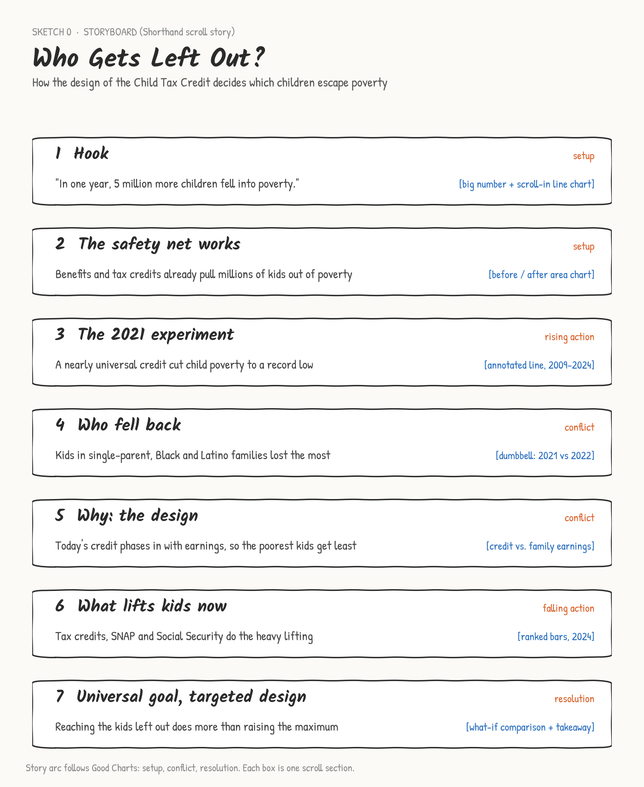
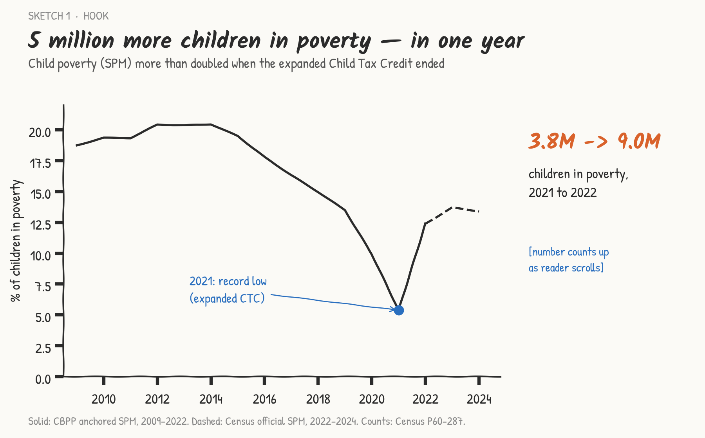
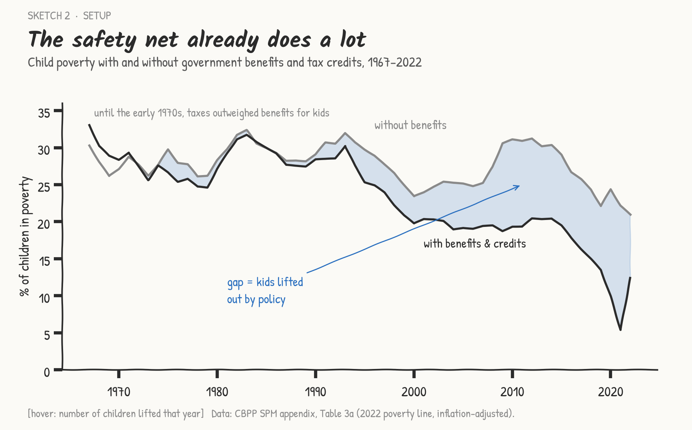
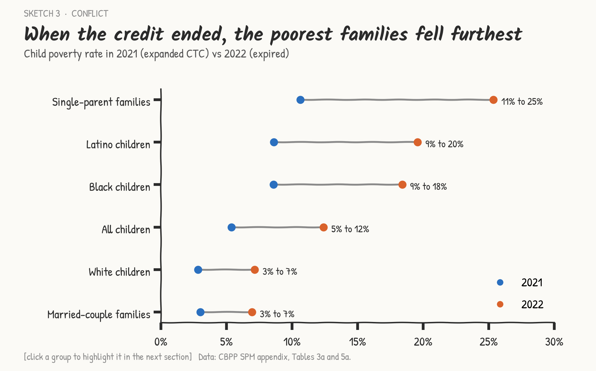
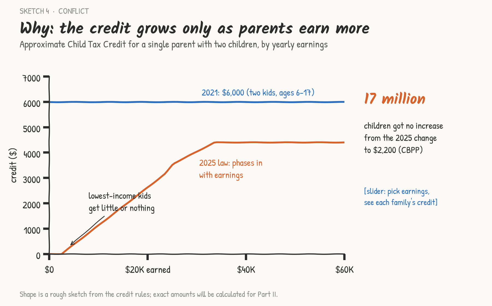
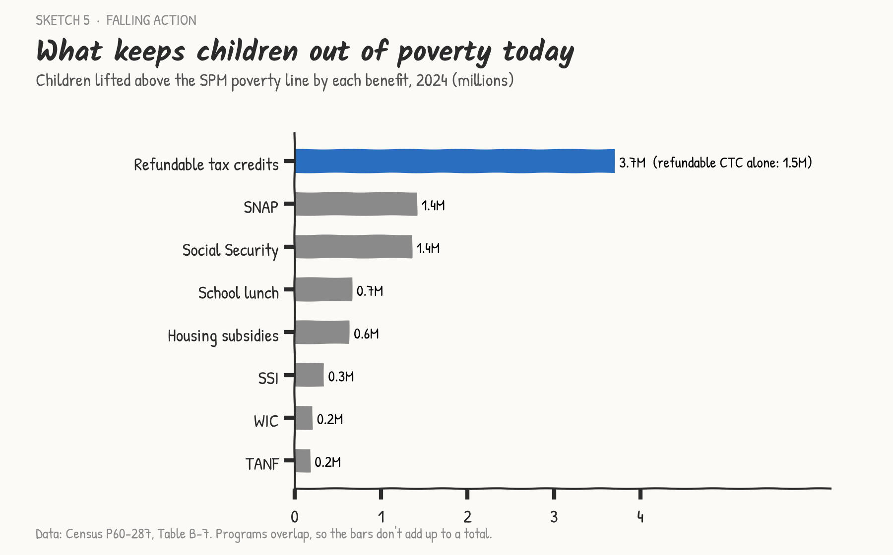
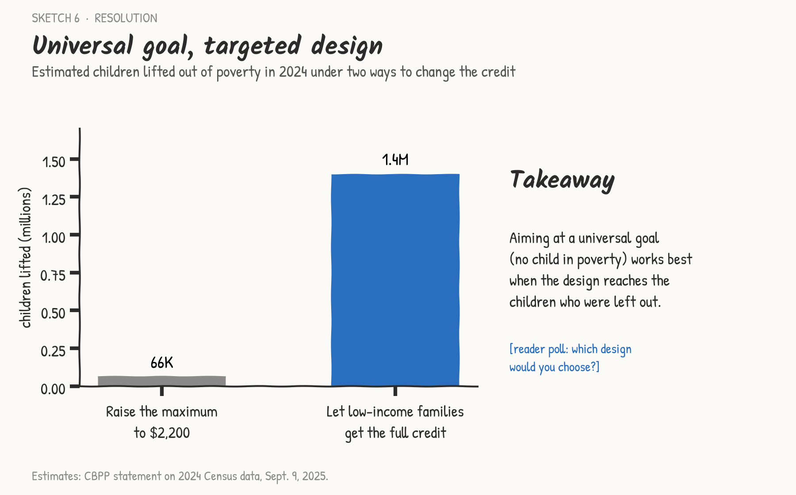

[← Portfolio home](./) · **Part I** · [Part II](final-project-part-two) · [Part III](final-project-part-three)

# Final Project, Part I: Who Gets Left Out?

### How the design of the Child Tax Credit decides which children escape poverty

**One-sentence summary:** In 2021, a temporary Child Tax Credit that reached nearly every child cut U.S. child poverty to a record low. When it expired, poverty more than doubled. Who a benefit reaches matters as much as how big it is.

---

## 1. Project summary

In 2021, the share of American children living in poverty fell to 5.2%, the lowest rate on record under the Census Bureau's Supplemental Poverty Measure (SPM). A year later it was 12.4%. Roughly 5 million more children were in poverty. A major reason was the expiration of the expanded Child Tax Credit (CTC). In 2021 the credit was fully refundable: families with little or no income received the full amount. In 2022 it returned to a design that phases in with earnings, so children in the lowest-income families once again got a partial credit or none.

My project uses that before-and-after moment to explore a broader idea: **targeted universalism**, which john a. powell and colleagues define as "setting universal goals pursued by targeted processes to achieve those goals." The universal goal here is simple: no child grows up in poverty. The data shows that reaching that goal depends on targeted design choices, such as whether a credit reaches families with the lowest incomes. Recent debates make this concrete. The 2025 law raised the maximum credit to $2,200, but about 17 million children get no increase because their families earn too little to qualify for the full amount.

I want readers to come away understanding three things: the safety net already keeps millions of children out of poverty; the 2021 credit showed how much more is possible; and the specific design choice that decides which children are left out. I will present the evidence and the trade-offs that policymakers debate, such as cost and work incentives, rather than argue for one party's position.

## 2. Project structure

### Audience

My main audience is people who are not policy experts: students, voters, and parents who have heard of the Child Tax Credit but don't know how it works. A second audience is policy students, such as my classmates in public policy programs, who want a clear visual summary of the evidence.

### User stories

- As a **parent who files taxes**, I want to see how the credit changes with income, so that I understand why some families get much less than others.
- As a **student new to poverty policy**, I want to see which programs keep children out of poverty, so that I can compare them on the same scale.
- As a **voter following the debate**, I want to see what different credit designs would actually do, so that I can judge proposals on evidence rather than slogans.

### Story arc

The story follows the arc from *Good Charts*: setup, conflict, and resolution. Each section will be one scrolling section in Shorthand.

| # | Section | Story beat | Key message | Planned visualization |
| --- | --- | --- | --- | --- |
| 1 | Hook: "5 million more children" | Setup | Child poverty more than doubled in a single year | Large number plus line chart, 2009–2024 |
| 2 | The safety net works | Setup | Benefits and tax credits already cut child poverty sharply | Line chart with and without benefits, 1967–2022 |
| 3 | The 2021 experiment | Rising action | A credit that reached nearly every child produced a record low | Annotated line chart and policy timeline |
| 4 | Who fell back | Conflict | Children in single-parent, Black, and Latino families saw the largest increases | Dumbbell chart, 2021 vs. 2022 |
| 5 | Why: the design | Conflict | Today's credit phases in with earnings, so the poorest children get the least | Credit amount by family earnings, with a slider |
| 6 | What lifts children now | Falling action | Tax credits, SNAP, and Social Security do the most work today | Ranked bar chart, 2024 |
| 7 | Universal goal, targeted design | Resolution | Reaching the children left out does more than raising the maximum; trade-offs remain | Comparison of two designs, then the takeaway |

**Ending:** The story closes by asking readers which design they would choose, after showing the main arguments on each side: cost, work incentives, and poverty reduction.

## 3. Initial sketches

I drew the sketches from the real data so the shapes are accurate, but the styling is rough on purpose. Notes in [blue brackets] mark planned interactions.

### Storyboard

The storyboard shows the order of the seven sections and the story beat each one plays.

### Section 1: Hook

The story opens with the jump from 3.8 million to 9.0 million children in poverty. The line chart shows the record low in 2021 and the rebound when the expanded credit ended.

### Section 2: The safety net works

Two lines show what child poverty would be without government help (gray) and what it actually is (black). The shaded gap is the number of children kept out of poverty by policy. The gap has grown since the 1990s.

### Section 3: The 2021 experiment

This section reuses the line chart from Section 1, adding a timeline of what changed in 2021: a larger credit, full refundability, and monthly payments from July to December.

### Section 4: Who fell back

Each row compares a group's poverty rate in 2021 and 2022. Children in single-parent families went from 11% to 25%.

### Section 5: Why: the design

This chart explains the mechanism. Under the 2021 rules, a single parent with two school-age children received $6,000 at any income up to $112,500. Under current rules, the credit starts at zero and rises only as parents earn more, so the lowest-income children receive little or nothing.

### Section 6: What lifts children now

A ranked bar chart shows how many children each program lifts above the poverty line today. Refundable tax credits lead at 3.7 million children.

### Section 7: Universal goal, targeted design

The closing comparison uses CBPP's estimates for 2024: raising the maximum credit to $2,200 would have lifted only about 66,000 more children out of poverty, while letting low-income families receive the full credit would have lifted about 1.4 million.

## 4. The data

My main dataset is the Excel appendix to the Center on Budget and Policy Priorities' (CBPP) 2024 report on poverty after pandemic relief expired. It uses the Supplemental Poverty Measure, which counts benefits and tax credits as income and subtracts taxes and necessary expenses. That makes it the right measure for this question; the official poverty measure ignores tax credits entirely. CBPP holds the poverty line constant after inflation, so rates can be compared from 1967 to 2022. The appendix also estimates how many children each program lifted above the poverty line in selected years, and breaks the results down by race, ethnicity, and family type.

To extend the story to 2024, I use the Census Bureau's report *Poverty in the United States: 2024*. It provides the official SPM child poverty rates for 2021–2024 and the effect of each benefit on child poverty in 2024. For the policy sections, I use the Tax Policy Center for the 2021 credit's rules and CBPP's estimates of who is left out of the current credit and what different designs would do.

I wrote a Python script to clean the CBPP workbook into tidy CSV files that Tableau can read directly, with one row per year and group. When the Census changed its methods in 2017 and 2020, CBPP reported those years twice; my files keep the updated version and note the change. Because CBPP's series and the official Census series set the poverty line slightly differently (5.4% vs. 5.2% in 2021), every chart will label which source it uses.

### Data files

All cleaned files are in this repository's [data folder](data/), along with a [data dictionary](data/) and the [cleaning script](data/build_data.py).

| File | Used in sections | Source |
| --- | --- | --- |
| [child_poverty_by_race_1967_2022.csv](data/child_poverty_by_race_1967_2022.csv) | 1, 2, 4 | CBPP appendix, Table 3a |
| [child_poverty_by_family_type_1967_2022.csv](data/child_poverty_by_family_type_1967_2022.csv) | 4 | CBPP appendix, Table 5a |
| [children_lifted_by_program_selected_years.csv](data/children_lifted_by_program_selected_years.csv) | 3, 6 | CBPP appendix, Table 8a |
| [census_spm_child_poverty_2021_2024.csv](data/census_spm_child_poverty_2021_2024.csv) | 1, 3 | Census P60-287, Table B-2 |
| [census_spm_child_resource_effects_2024.csv](data/census_spm_child_resource_effects_2024.csv) | 6 | Census P60-287, Tables B-6 and B-7 |
| [ctc_policy_timeline.csv](data/ctc_policy_timeline.csv) | 3, 5 | Public laws, Tax Policy Center, CBPP, Thomson Reuters |

### Still to collect for Part II

- **Credit amounts by earnings:** I will calculate the exact credit at each earnings level for a few family types from the tax rules, replacing the rough shape in Sketch 4.
- **Arguments on each side:** I will find sources on the costs and work-incentive concerns raised about a fully refundable credit, so that the ending presents both sides.
- **State-level data (optional):** The Census publishes SPM child poverty by state as three-year averages. Adding Pennsylvania could make the story more local for my audience.

## 5. Method and medium

I will build the story in **Shorthand** as a scrolling story, with each of the seven sections as its own scene. The charts will be built in **Tableau Public** and embedded in Shorthand, so readers can hover for exact values, filter by group in Section 4, and use an earnings slider in Section 5.

I will keep the visual design consistent with my sketches: gray for context, blue for the 2021 credit, and orange for the change after it expired. Every chart will include a source line, and I will check colors for color-blind readers. The finished story will be linked from Part III of this portfolio.

## Sources

- Center on Budget and Policy Priorities. ["About 16 Million Children in Low-Income Families Would Gain in First Year of Bipartisan Child Tax Credit Expansion."](https://www.cbpp.org/research/federal-tax/about-16-million-children-in-low-income-families-would-gain-in-first-year-of) January 16, 2024.
- Trisi, Danilo. ["Expiration of Pandemic Relief Led to Record Increases in Poverty and Child Poverty in 2022."](https://www.cbpp.org/research/poverty-and-inequality/expiration-of-pandemic-relief-led-to-record-increases-in-poverty) CBPP, June 10, 2024, with Excel appendix.
- Parrott, Sharon. ["Statement on 2024 Census Income, Poverty, and Health Insurance Data."](https://www.cbpp.org/sites/default/files/9-9-25pov-stmt.pdf) CBPP, September 9, 2025.
- Shrider, Emily A., and Christina Bijou. [*Poverty in the United States: 2024*.](https://cps.ipums.org/cps/resources/poverty/PovReport24.pdf) U.S. Census Bureau Report P60-287, September 2025.
- Tax Policy Center. ["How did the 2021 American Rescue Plan Act change the child tax credit?"](https://taxpolicycenter.org/briefing-book/how-did-2021-american-rescue-plan-act-change-child-tax-credit) Briefing Book.
- powell, john a., Stephen Menendian, and Wendy Ake. [*Targeted Universalism: Policy & Practice*.](https://escholarship.org/content/qt9sm8b0q8/qt9sm8b0q8.pdf) Haas Institute for a Fair and Inclusive Society, UC Berkeley, 2019.
- Thomson Reuters. ["Tax bill fails to pass Senate hurdle."](https://tax.thomsonreuters.com/news/tax-bill-fails-to-pass-senate-hurdle/) August 2, 2024.
- Berinato, Scott. *Good Charts*. Harvard Business Review Press, 2016.

---

[← Portfolio home](./) · **Part I** · [Part II](final-project-part-two) · [Part III](final-project-part-three)
